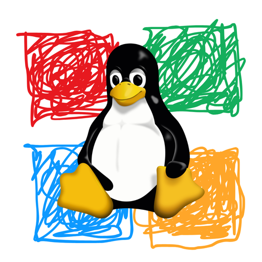

<p align="center">
  
</p>

<h1 align="center">TuxOffice</h1>

<p align="center">
  <strong>Microsoft 365 desktop apps on Linux, running natively — no virtual machine, no remote desktop.</strong>
</p>

<p align="center">
  
  
  
  
</p>

<p align="center">
  
</p>

TuxOffice installs and runs the real Microsoft 365 Apps (Word, Excel,
PowerPoint, Outlook, OneNote, Access and Publisher) on a Linux desktop.
Office's x86-64 code runs directly on your CPU; its Windows, COM, Direct2D and
composition calls are answered by a Wine runner built from Valve's Proton Wine,
Bottles' [Soda](https://github.com/bottlesdevs/wine) Office patches and
TuxOffice's own fixes in [`wine/`](wine). One command builds the runner and
the Office environment, and another installs Office from Microsoft's
servers. You then sign in with the Microsoft account that holds your
subscription.

## Highlights

- **Activation by signing in.** Office activates with your own Microsoft 365
  account through a browser sign-in. No KMS tools, no product-key tricks.
- **A Linux desktop citizen.** Open and Save As use your desktop's file
  chooser (Dolphin's dialog on Plasma) and save straight into your Linux
  folders. Text, HTML and images copy and paste with native apps. You can
  drag files from your file manager into Office. Office follows the desktop's
  light or dark theme, and its apps get desktop entries, icons and file
  associations.
- **Native Wayland.** Office uses Wine's Wayland driver, with Windows 11 caption
  buttons, frame shadows, crisp text at fractional scales, and modal dialogs
  that stay above their window.
- **GPU rendering.** Direct3D goes through a bundled, patched DXVK on Vulkan;
  Office's composition layers are drawn as Wayland subsurfaces and clipped to
  their windows.
- **Tested in a sandbox.** An automated suite drives the apps in a private,
  nested KWin session and checks documents, PDF export, charts, spelling,
  ribbon rendering, scrolling performance, frame shadows, dialogs and the
  file chooser.

## Status

TuxOffice is under active development and used daily on KDE Plasma (Wayland)
at 1.25× scaling. Tested with Office 16.0.20527 (Current Channel, x64):

| App | State |
| --- | --- |
| Word, Excel, PowerPoint | Open, edit, save, print to PDF, charts, slide shows, spelling |
| OneNote | Notebooks open, text input works |
| Outlook | Starts and reaches account setup |
| Access | Opens to its start page |
| Publisher | Installed; sign-in licensing is not working yet |

Known limitations, measurements and the full change history are in
[`docs/STATUS.md`](docs/STATUS.md). In short: dragging *out of* Office into Linux
apps is not implemented, Office's embedded sign-in page has minor rendering
glitches, and there is no matched Windows baseline, so performance parity with
Windows is not claimed.

## Requirements

- A 64-bit Linux desktop. Wayland is recommended and KDE Plasma is the tested
  desktop; X11 sessions use Wine's X11 driver and are less tested.
- A Vulkan-capable GPU and driver (`vulkaninfo` should work).
- Linux 6.14 or later for `ntsync` (optional; older kernels fall back to the
  wineserver).
- A Microsoft 365 subscription that includes the desktop apps.
- Tools: `bash`, `curl`, `python3`, `7z`, `unzip`, `git`, and
  `xdg-desktop-portal` with a FileChooser backend (for the native file dialogs).
- To build the patched runner: `clang`, `lld`, `bison`, `flex`, `meson`,
  `ninja`, `glslangValidator`, Wine's usual development libraries (Wayland,
  Vulkan, FreeType, fontconfig, …) and `libsystemd` headers.

## Quick start

```sh
git clone <this repository> TuxOffice
cd TuxOffice

./tuxoffice setup      # runner, Office environment, fonts and Windows components
./tuxoffice install    # downloads and installs Microsoft 365 Apps (about 3.5 GB)
./tuxoffice run word   # sign in when Office asks
./tuxoffice fonts cloud   # after signing in: fetch Segoe UI, Aptos, Calibri, …
./tuxoffice set-default   # optional: open Office files with TuxOffice
```

`setup` builds the TuxOffice runner from [`wine/`](wine) the first time (an
overlay build takes a few minutes). `install` also creates the desktop
entries, so the apps appear in your application menu.

Check your environment at any time with `./tuxoffice doctor`.

## Commands

| Command | Purpose |
| --- | --- |
| `setup` | Download the base runner, build the TuxOffice runner and create the Office environment |
| `install [--config FILE]` | Install Office with Click-to-Run (default: [`config/m365-apps.xml`](config/m365-apps.xml)) |
| `install-status` | Show Click-to-Run progress |
| `run APP [FILES…]` | Launch `word`, `excel`, `powerpoint`, `outlook`, `onenote`, `access` or `publisher` |
| `integrate` / `unintegrate` | Add or remove desktop entries and icons |
| `set-default` | Make TuxOffice the default handler for Office documents |
| `fonts status\|office\|cloud\|import PATH\|segoe` | Inspect and install the fonts Office expects |
| `graphics auto\|builtin\|dxvk` | Choose the Direct3D backend for Office |
| `ui` | Re-apply Windows UI fonts, colours and window effects |
| `repair` | Re-register Office's chart proxies and Windows Installer components |
| `doctor` | Check the runner, environment, kernel, Vulkan and installed apps |
| `wine ARGS…` | Run a command in the Office environment (`winecfg`, `regedit`, …) |
| `kill` | Stop every process in the Office environment |

### Configuration

| Variable | Effect |
| --- | --- |
| `TUXOFFICE_HOME` | Data directory (default `~/.local/share/tuxoffice`) |
| `TUXOFFICE_PREFIX` | Office environment (default `$TUXOFFICE_HOME/prefixes/office`) |
| `TUXOFFICE_RUNNER` | Use a specific runner directory |
| `TUXOFFICE_GRAPHICS=builtin` | Use Wine's built-in Direct3D for one launch |
| `TUXOFFICE_FILE_DIALOG=wine` | Use Wine's own Open/Save dialogs instead of the desktop's |
| `TUXOFFICE_THEME=light\|dark` | Override the desktop's colour scheme for Office |
| `TUXOFFICE_SCALE` | Override the detected display scale |
| `TUXOFFICE_X11=1` | Run through XWayland instead of the native Wayland driver |

## How it works

```
tuxoffice (launcher)
  ├─ runner      Soda base runner + modules rebuilt from wine/ (runner/build.sh)
  │                └─ patched DXVK bundle (runner/build-dxvk.sh, runner/patches/)
  ├─ prefix      Office's Windows environment: fonts, Windows components,
  │              Click-to-Run service, chart proxies, Installer components
  ├─ install     Office's payload is fetched natively from Microsoft's CDN
  │              (lib/c2rfetch.py), then installed offline by Click-to-Run
  └─ desktop     desktop entries, MIME types, theme and scale detection,
                 tuxoffice-file-dialog (xdg-desktop-portal file chooser)
```

[`wine/`](wine) holds the complete Wine source. The commit whose subject
starts with `soda` imports the Soda 11.0-33 base (Valve's Proton Wine with
Bottles' Office patch set). Every TuxOffice change to Wine is a separate commit
after it. `runner/build.sh` rebuilds only the modules changed since that base
and lays them over the pinned Soda release, so a rebuild takes minutes, not
hours.

## Repository layout

| Path | Contents |
| --- | --- |
| [`tuxoffice`](tuxoffice) | The launcher: setup, install, run, fonts, integration |
| [`wine/`](wine) | Wine source: Soda base plus TuxOffice's Wine commits |
| [`runner/`](runner) | Runner and DXVK build scripts and DXVK patches |
| [`lib/`](lib) | Helpers: CDN fetcher, file chooser, font tools, registry repair |
| [`config/`](config) | Click-to-Run configuration for Microsoft 365 Apps |
| [`tests/`](tests) | Automated tests, probes and the isolated test session |
| [`bench/`](bench) | Recorded measurements |
| [`docs/`](docs) | Status and change history, research notes |

## Development and testing

Build the runner after changing anything in `wine/` or `lib/`:

```sh
runner/build.sh                                  # overlay build into ~/.local/share/tuxoffice
TUXOFFICE_HOME=/tmp/candidate runner/build.sh    # or into a separate home to test first
```

GUI tests run in a private nested KWin session, so they never take over your
desktop. The session works on a copy of your Office environment (a reflink
copy, so it is quick and small) and builds the small Windows test programs:

```sh
tests/isolated-session.sh SESSION &              # start the private session
python3 tests/isolated-run.py SESSION python3 tests/office-suite.py RESULTS
```

Each test script documents its arguments at the top; see
[`docs/STATUS.md`](docs/STATUS.md) for the current results and how they were
measured.

## Troubleshooting

- **An app does not start:** run `./tuxoffice doctor`, then `./tuxoffice kill`
  and try again. Office asks to start in safe mode after a crash; answering
  *No* is usually fine.
- **Graphics problems:** try `TUXOFFICE_GRAPHICS=builtin ./tuxoffice run word`,
  or switch permanently with `./tuxoffice graphics builtin`.
- **Open/Save dialogs:** `TUXOFFICE_FILE_DIALOG=wine` falls back to Wine's dialog.
- **Fonts look wrong:** `./tuxoffice fonts status`, then `./tuxoffice fonts
  cloud` after signing in.

## Credits

TuxOffice stands on the work of [Wine](https://www.winehq.org/),
[Valve's Proton Wine](https://github.com/ValveSoftware/wine),
[Bottles' Soda](https://github.com/bottlesdevs/wine) and
[DXVK](https://github.com/doitsujin/dxvk).

## License and trademarks

The Wine source in [`wine/`](wine), including TuxOffice's changes to it, is
licensed under the GNU LGPL 2.1 or later, like Wine; see
[`wine/COPYING.LIB`](wine/COPYING.LIB).

TuxOffice is not affiliated with or endorsed by Microsoft. Microsoft, Microsoft
365, Word, Excel, PowerPoint, Outlook, OneNote, Access and Publisher are
trademarks of the Microsoft group of companies. TuxOffice does not include or
distribute any Microsoft software: Office and its fonts are downloaded from
Microsoft, and using them requires your own licence.
